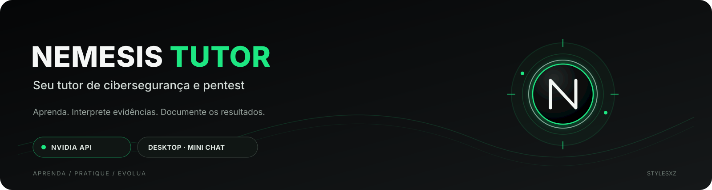
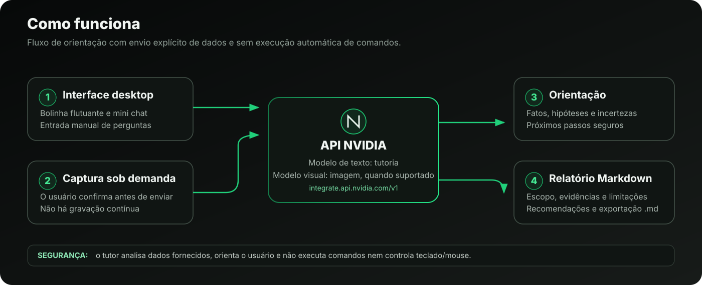

  
    
  
<strong>Um tutor desktop para aprender cibersegurança, interpretar resultados e documentar pentests autorizados.</strong>

  

    
    
    
    
  

  
<em>Aprenda · Pratique · Evolua</em>

---

## Visão geral

O **NEMESIS Tutor** é um aplicativo desktop em Python com interface nativa. Ele foi pensado para acompanhar o estudo de segurança ofensiva responsável: você descreve o objetivo, compartilha comandos ou resultados e recebe uma explicação didática sobre evidências, hipóteses, limitações e próximos passos seguros.

A interface utiliza uma **bolinha flutuante** que abre um mini chat, sem depender de uma página no navegador. Há também uma área de relatório para montar e exportar documentação em Markdown.

> **Estado do projeto:** protótipo em desenvolvimento. A imagem abaixo é uma prévia conceitual da interface — não uma captura de uma execução real. A disponibilidade de modelos, captura de tela e compatibilidade gráfica precisa ser validada no computador de destino.

## Prévia da interface

  

## Funcionalidades

| Recurso | Descrição |
|---|---|
| **Bolinha flutuante** | Fica acima das outras janelas e pode ser arrastada; clique para abrir ou ocultar o mini chat. |
| **Tutor por chat** | Explica conceitos, parâmetros de comandos e saídas fornecidas pelo usuário, em português. |
| **Análise de tela sob demanda** | Solicita confirmação antes de capturar a tela principal e encaminhar a imagem à API configurada. |
| **Interpretação cautelosa** | Ajuda a separar observações visíveis, interpretações prováveis, incertezas e próximos passos. |
| **Relatório Markdown** | Permite gerar, revisar e salvar documentação em .md com o material disponível. |
| **Configuração de modelos** | IDs dos modelos de texto e visão podem ser alterados na janela de configurações. |
| **Linux e Windows** | Inclui scripts de instalação e inicialização para os dois sistemas. |

## Arquitetura em alto nível

  

## Modelos NVIDIA

A aplicação usa a API compatível com o formato OpenAI no endpoint <code>https://integrate.api.nvidia.com/v1</code>. Os IDs iniciais configurados no código são:

| Papel | Modelo padrão | Uso esperado |
|---|---|---|
| Tutoria e raciocínio | <code>nvidia/nemotron-3-ultra-550b-a55b</code> | Conversa textual e explicação dos resultados fornecidos. |
| Análise visual | <code>nvidia/nemotron-3.5-super-vl-120b-a12b</code> | Análise de capturas de tela, desde que o endpoint esteja habilitado para a conta. |

**Importante:** a presença de um ID no aplicativo não garante que o endpoint esteja habilitado para sua conta. Modelos, limites, cotas, nomes e permissões podem mudar. Confirme a disponibilidade atual no [catálogo NVIDIA](https://build.nvidia.com/models) e use um modelo compatível com a tarefa. Uma chave NVIDIA válida é necessária para chamadas remotas.

## Requisitos

- Linux desktop (Debian, Ubuntu ou distribuição semelhante) ou Windows 10/11.
- Python **3.10 ou superior**. A instalação Linux fixa o PySide6 em <code>6.9.3</code> para evitar um requisito de instruções de CPU presente em algumas wheels Qt mais recentes.
- Dependências listadas em <code>requirements.txt</code>.
- Conexão à internet e uma chave de API NVIDIA com acesso a pelo menos um dos modelos configurados.
- No Linux, um ambiente gráfico. Em Wayland, as permissões de captura dependem do compositor e da sessão usada.

## Instalação

### Linux (Debian / Ubuntu / Kali)

1. Instale Python, ambientes virtuais e bibliotecas gráficas se ainda não estiverem disponíveis:

   <pre><code>sudo apt update
sudo apt install -y python3 python3-venv python3-pip libgl1 libegl1 libxkbcommon-x11-0 libxcb-cursor0</code></pre>

2. Clone o repositório e entre na pasta:

   <pre><code>git clone https://github.com/stylesxzz/Nemesis-tutor.git
cd Nemesis-tutor</code></pre>

3. Instale as dependências e inicie o aplicativo:

   <pre><code>chmod +x ./*.sh
./install_linux.sh
./start_linux.sh</code></pre>

Se a instalação do Python da distribuição não tiver suporte a <code>venv</code>, instale o pacote <code>python3-venv</code> correspondente à versão do Python instalada.

### Windows

1. Instale Python 3.10+ e habilite a opção de adicionar Python ao <code>PATH</code>.
2. Abra a pasta do repositório no Explorador de Arquivos.
3. Execute <code>install_windows.bat</code> e, depois, <code>run_windows.bat</code>.

## Primeira utilização

1. Inicie o NEMESIS Tutor e clique na bolinha com a letra **N**.
2. Abra **Configurações (⚙)** e informe sua chave da API NVIDIA.
3. Confira os IDs dos modelos. O modelo visual precisa aceitar entradas de imagem.
4. Descreva o laboratório, o escopo autorizado e o que está tentando aprender.
5. Cole manualmente a saída de um comando ou use **Analisar tela** quando quiser enviar uma captura.
6. Revise as conclusões e as incertezas antes de usá-las.
7. Na página **Relatório**, gere o documento e use **Salvar .md** para exportar.

## Privacidade e segurança

- A captura é iniciada manualmente e exige confirmação; o aplicativo não mantém gravação contínua da tela.
- Quando você confirma uma captura, a imagem sai do computador e é enviada ao endpoint NVIDIA configurado. Oculte dados pessoais, senhas, tokens, chaves, mensagens privadas e informações confidenciais antes de enviar.
- A chave pode ser fornecida pela variável de ambiente <code>NVIDIA_API_KEY</code>, informada na janela de configurações e, opcionalmente, guardada no cofre do sistema operacional, se o backend <code>keyring</code> estiver disponível. Não coloque chaves em commits, issues, capturas ou arquivos de documentação.
- O aplicativo **não executa comandos**, não controla teclado/mouse e não realiza pentests automaticamente. Você é responsável por decidir e executar cada ação.
- Use somente em equipamentos próprios, laboratórios ou sistemas com autorização explícita. Evite ações destrutivas; registre escopo, evidências e limitações.
- As respostas são auxílio educacional, não substituem validação manual, revisão técnica ou um relatório de auditoria independente.

## Solução de problemas

### <code>Incompatible processor ... sse4.2 popcnt</code>

Algumas wheels Qt 6.10+ podem exigir instruções de CPU que não estão disponíveis para o processador ou para a máquina virtual. Este projeto fixa <code>PySide6==6.9.3</code> em <code>requirements.txt</code>. Na pasta do repositório, tente:

<pre><code>./fix_qt_cpu.sh
./start_linux.sh</code></pre>

### <code>ModuleNotFoundError: No module named 'PySide6.QtCore'</code>

O ambiente virtual provavelmente está incompleto. O script de reparo recria **somente** a pasta <code>.venv</code>, reinstala as dependências e testa os módulos Qt:

<pre><code>./repair_linux.sh
./start_linux.sh</code></pre>

### Erros da API NVIDIA

- **401:** confira se a chave está correta, ativa e sem espaços adicionais.
- **403 / acesso negado:** confirme se sua conta pode utilizar o modelo selecionado.
- **404 / modelo não encontrado:** verifique o ID e a disponibilidade do endpoint no catálogo NVIDIA.
- **429 / limite ou cota:** verifique os limites da sua conta e tente novamente quando permitido.
- **Captura em Wayland:** o compositor pode restringir captura de tela. Teste em uma sessão gráfica autorizada e confira as permissões de compartilhamento/captura.

## Estrutura do projeto

<pre><code>Nemesis-tutor/
├── assets/
│   ├── architecture.svg
│   ├── nemesis-banner.svg
│   └── ui-preview.png
├── main.py
├── requirements.txt
├── install_linux.sh
├── start_linux.sh
├── fix_qt_cpu.sh
├── repair_linux.sh
├── install_windows.bat
├── run_windows.bat
└── README.md</code></pre>

## Roadmap

- [ ] Testar instalação limpa em diferentes distribuições Linux e versões do Windows.
- [ ] Validar endpoints e modelos disponíveis na NVIDIA no momento da execução.
- [ ] Melhorar compatibilidade com captura de tela em sessões Wayland.
- [ ] Adicionar testes automatizados para as rotas de chat, visão e geração de relatório.
- [ ] Refinar diagnósticos para falhas de rede, permissão e dependências Qt.

## Contribuição

Relate bugs e sugestões pela aba **Issues** do repositório. Ao abrir uma issue, inclua sistema operacional, versão do Python, mensagem de erro completa e os passos para reproduzir — **nunca** publique sua chave da API nem dados sensíveis de uma captura.

## Aviso legal

Este projeto foi criado para educação, pesquisa e uso defensivo autorizado. A responsabilidade pelo escopo e pelos testes realizados é de quem utiliza a ferramenta.

---

  Desenvolvido por <a href="https://github.com/stylesxzz">stylesxzz</a> · NEMESIS Tutor 
  APRENDA · PRATIQUE · EVOLUA

